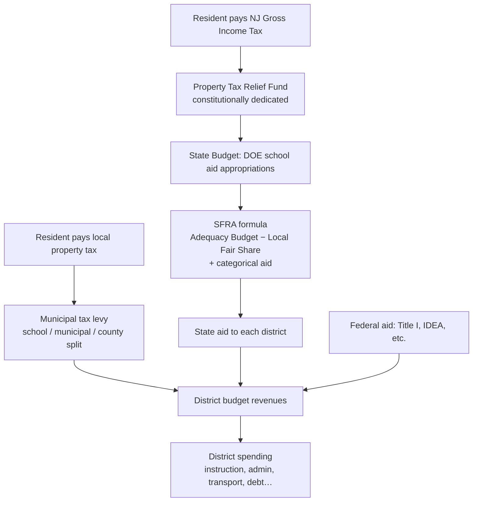

# NJ School Funding

Data gathering and analysis on how New Jersey pays for public schools, from the taxes residents pay to the dollars each school district receives and spends.

This repo is for the research phase. A public-facing website will come later.

## The money flow



Each stage and the dataset that documents it are listed in **[SOURCES.md](SOURCES.md)**.

## Layout

```
SOURCES.md          catalog of data sources, by money-flow stage
docs/               notes, glossary, methodology
scripts/            download / parse scripts
data/raw/           downloaded source files (git-ignored; re-create with scripts/download.sh)
data/processed/     cleaned, joined tables (committed)
analysis/           notebooks and analysis
```

## Getting started

```bash
./scripts/download.sh          # fetches the core datasets into data/raw/
```

## Infrastructure

Most sources are plain file downloads from nj.gov and work with `curl` (see `scripts/download.sh`). For pages that need a real browser, this project can use the shared Playwright scraper service (`Profitnaut/playwright-scraper`):

- **Droplet (datacenter IP):** the default for rendered pages. Endpoints: `/fetch-html` (headless Chromium, with optional wait-for-selector), `/fetch-paginated`, `/fetch-raw` (files and PDFs), and `/health/deep`. Requests authenticate with an API key header, which is stored in 1Password and never committed.
- **Residential scraper (Raspberry Pi on a home connection):** the same service, used **only** as a last resort for sites that block datacenter IPs. Keep requests rare and spaced out, because a burst of about 10 hits has gotten the home IP blocked before.
- **Local instance:** when the scraper is running on your machine, use `scripts/fetch_rendered.sh <url>` with `SCRAPER_API_KEY` set. It defaults to `http://localhost:8765` and fetches from your own IP.

NJDOE gotchas:
- Some NJDOE pages sit behind an Incapsula bot wall, including the School Directory CSV. Plan to download these by hand into `data/raw/manual/`, or test the scraper very gently.
- The School Performance Reports download page only shows its links in a browser, but the data files themselves download fine with curl. The old `rc.doe.state.nj.us` site is retired.
- Join on **NJ county + district codes**, never district names, because names repeat across counties.

## Key questions

1. How much of each income-tax dollar ends up as school aid?
2. For each district, what share of revenue comes from state, local, and federal sources?
3. Which districts receive less than SFRA says they should (adequacy gap), and which tax above or below their Local Fair Share?
4. How do the FY26+ aid caps (+6% / −3%) change who wins and who loses?
5. Where does the money go once it reaches the district (TGES indicators)?
